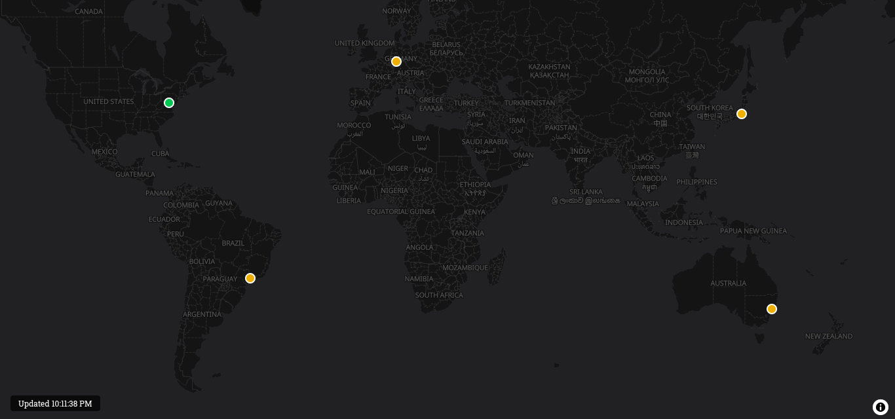
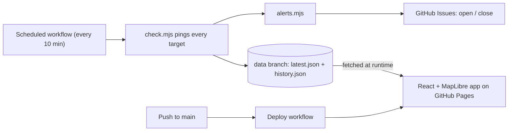

# Global Network Status Map

A live world map that shows whether a set of servers are up, slow, or down. It runs entirely on GitHub: there is no backend, no database and no hosting bill.

**[View the live demo](https://sina-saeedi.github.io/status-map)**



## What it does

- Shows each monitored endpoint as a dot on a map: green is up, yellow is slow, red is down.
- Clicking a dot opens a panel with the current response time, 24-hour uptime and a latency chart.
- Checks every target on a schedule, and keeps the last 24 hours of results.
- Opens a GitHub issue automatically when a target is down for two checks in a row, and closes it when the target recovers.
- Redeploys the site whenever the code changes.

## How it works



1. A scheduled GitHub Actions workflow runs `scripts/check.mjs`, which requests every URL in `data/targets.json` and records the status and response time.
2. The results are committed to a separate `data` branch as `latest.json` (current snapshot) and `history.json` (last 24 hours).
3. A second script compares the results with the open issues and opens or closes outage issues.
4. The React app fetches the JSON files straight from the `data` branch, so new data appears without a redeploy.

### Why a separate `data` branch?

The checker commits about 144 times a day. Keeping those commits on their own branch keeps the history of `main` readable, avoids triggering CI and deploys on every check, and separates hand-written code from machine-generated output.

## Tech stack

- **Frontend:** React, TypeScript, Vite, Tailwind CSS, shadcn/ui, Recharts
- **Map:** MapLibre GL via `react-map-gl`, with free OpenFreeMap tiles
- **Automation:** GitHub Actions (scheduled checks, outage issues, Pages deployment)
- **Checker:** Node.js 22 (built-in `fetch`, no dependencies)

## Repository layout

```
.
├── .github/workflows/
│   ├── check.yml        # scheduled checks, saves results, opens/closes issues
│   └── deploy.yml       # builds the site and publishes to GitHub Pages
├── data/
│   └── targets.json     # the list of monitored endpoints
├── scripts/
│   ├── check.mjs        # pings targets, writes latest.json and history.json
│   └── alerts.mjs       # opens and closes outage issues
└── src/                 # React app
```

The `data` branch contains only `latest.json` and `history.json`.

## Workflows

| Workflow     | Trigger                       | What it does                                                                    |
| ------------ | ----------------------------- | ------------------------------------------------------------------------------- |
| `check.yml`  | Every 10 minutes, or manually | Runs the checker, commits results to `data`, then opens or closes outage issues |
| `deploy.yml` | Push to `main`, or manually   | Builds the Vite app and deploys it to GitHub Pages                              |

## Getting started

```bash
git clone https://github.com/sina-saeedi/status-map.git
cd status-map
npm install
cp .env.example .env
npm run dev
```

The app reads data from the `data` branch of the repository named in `.env`, so you see live results even when running locally.

To run the checker on your machine:

```bash
node scripts/check.mjs
```

This writes `latest.json` and `history.json` to `out/`.

## Adding a target

Add an entry to `data/targets.json`:

```json
{
  "id": "frankfurt",
  "name": "AWS Frankfurt",
  "url": "https://dynamodb.eu-central-1.amazonaws.com",
  "lat": 50.11,
  "lng": 8.68
}
```

The `id` must be unique, because it links a target to its results and its outage issue. Commit to `main`, and the target appears on the map after the next scheduled check.

## Running your own copy

1. Fork the repository and make sure Actions are enabled.
2. Create the `data` branch:
   ```bash
   git switch --orphan data
   git commit --allow-empty -m "chore: init data branch"
   git push -u origin data
   git switch main
   ```
3. In **Settings → Pages**, set the source to **GitHub Actions**.
4. Run the **Check targets** workflow once from the Actions tab, then push a change to `main` to trigger the deploy.

The deploy workflow passes your username and repository name to the build automatically.

## Design notes and limitations

- **Checks come from GitHub's servers, not from each location.** A dot means "reachable from GitHub's runners", not "fast for users in that region".
- **Status rules:** a target is _down_ if it does not respond within 10 seconds or returns a 5xx status, _slow_ if the response takes more than 300 ms, and _up_ otherwise. Any response below 500 counts as reachable.
- **Scheduled workflows are approximate.** GitHub can delay them by several minutes, and it pauses them after 60 days without repository activity.
- **Data can be a few minutes stale.** GitHub caches raw files briefly, so the app may lag slightly behind the latest check. The "Updated" label shows the real time of the last check.
- **Outage alerts need two failures in a row** to avoid false alarms from a single timeout.
- Coordinates are set by hand for each target, because IP geolocation of CDN-backed sites points to whichever edge server answered.

## License

MIT
